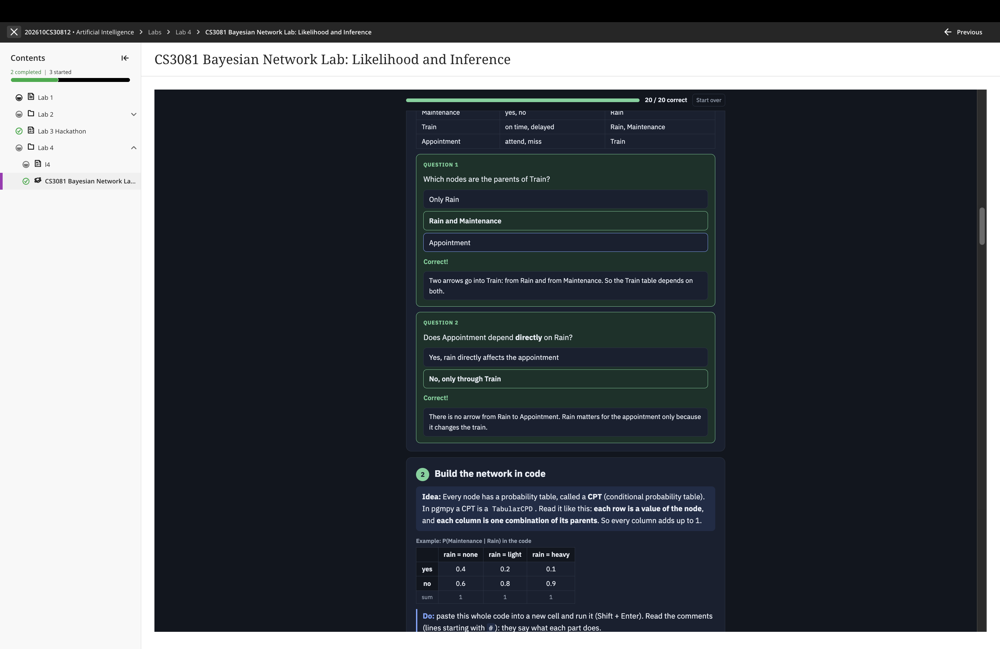
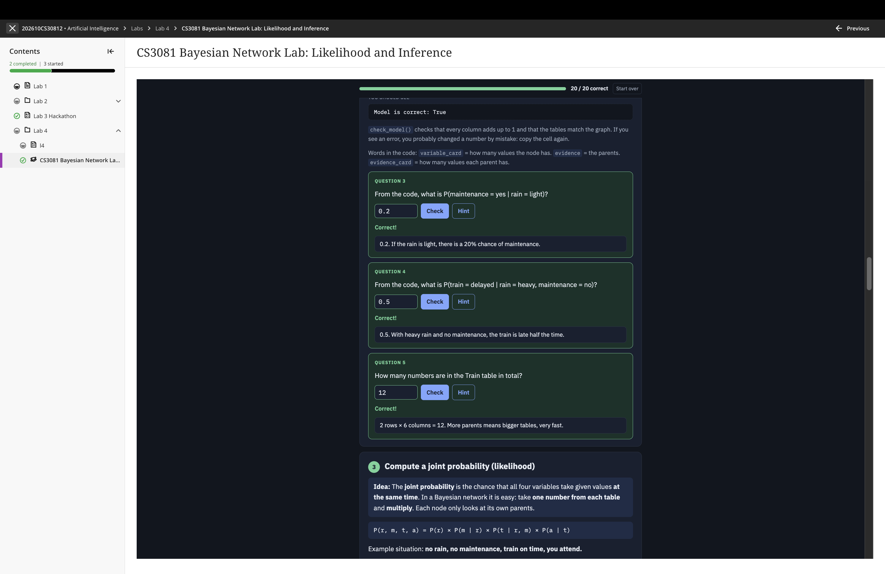
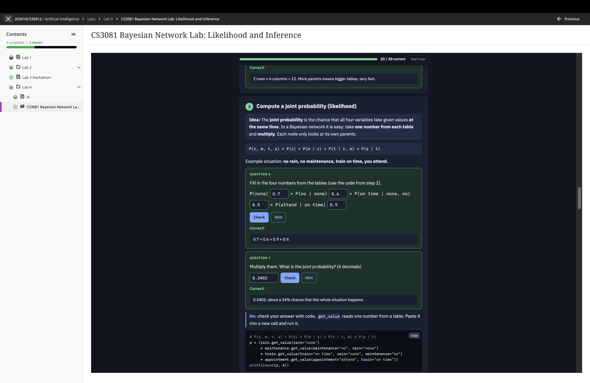
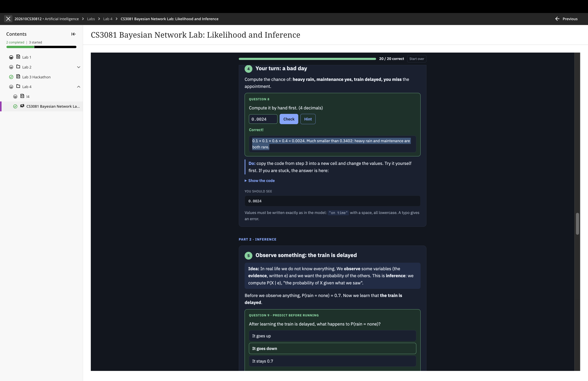
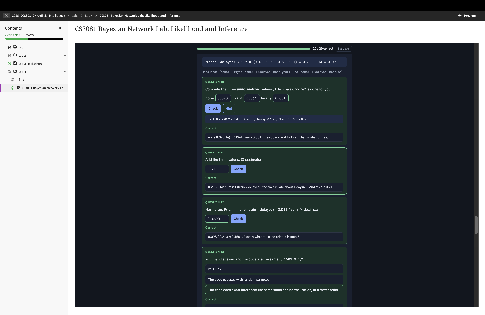
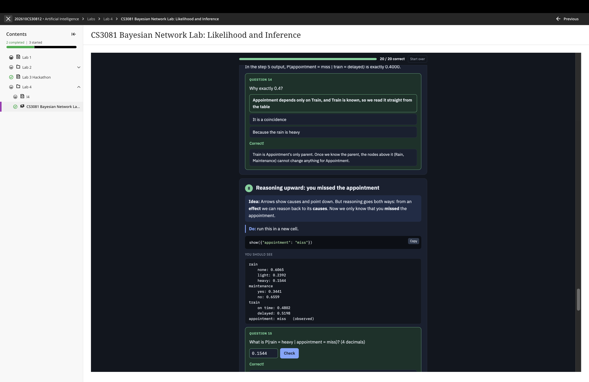
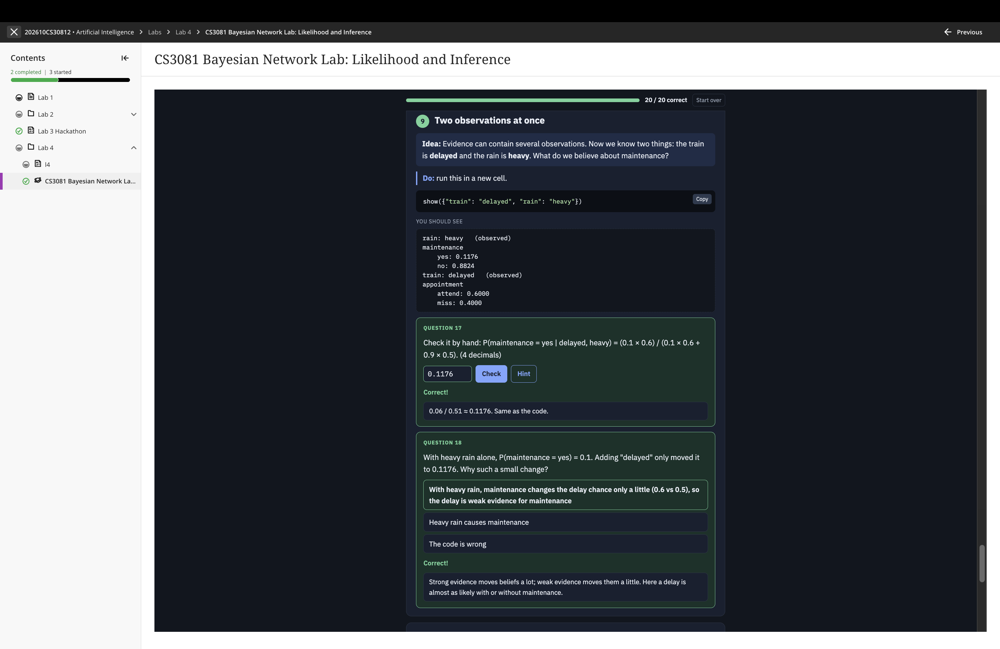
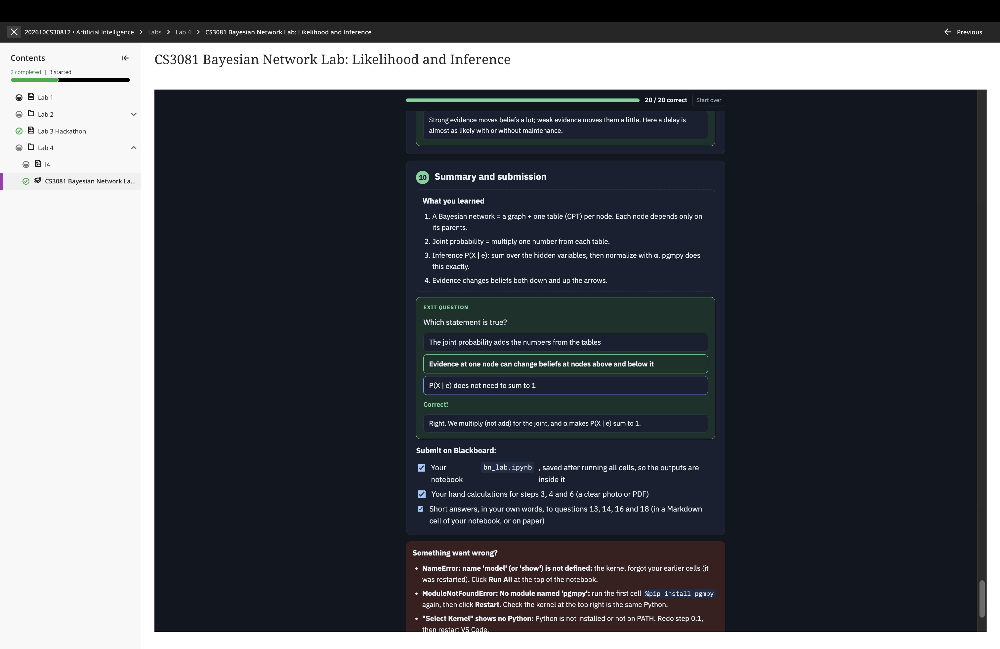

# BN_Lab: Bayesian Network Lab (Likelihood and Inference)

CS3081 · Artificial Intelligence · Lab 4

The notebook is in [`bn_lab.ipynb`](bn_lab.ipynb). Screenshots of the completed lab (20/20 correct) are below.

## 1. Reading the graph and building the network

Parents of Train, direct vs. indirect dependence, and how CPTs are built in pgmpy.

## 2. Reading values from the CPTs

`check_model()` output and questions on the Maintenance and Train tables.

## 3. Joint probability (likelihood)

P(r, m, t, a) = P(r) × P(m | r) × P(t | r, m) × P(a | t), with the example "no rain, no maintenance, train on time, you attend" = 0.3402.

## 4. A bad day, and the start of inference

Heavy rain, maintenance, train delayed, you miss the appointment = 0.0024. Then observing that the train is delayed.

## 5. Inference by hand: unnormalized values and normalization

none 0.098, light 0.064, heavy 0.051, sum 0.213, P(rain = none | train = delayed) ≈ 0.4600.

## 6. Reasoning upward: you missed the appointment

## 7. Two observations at once

P(maintenance = yes | delayed, heavy) ≈ 0.1176.

## 8. Summary and submission

[steps to solve written questions] image.png